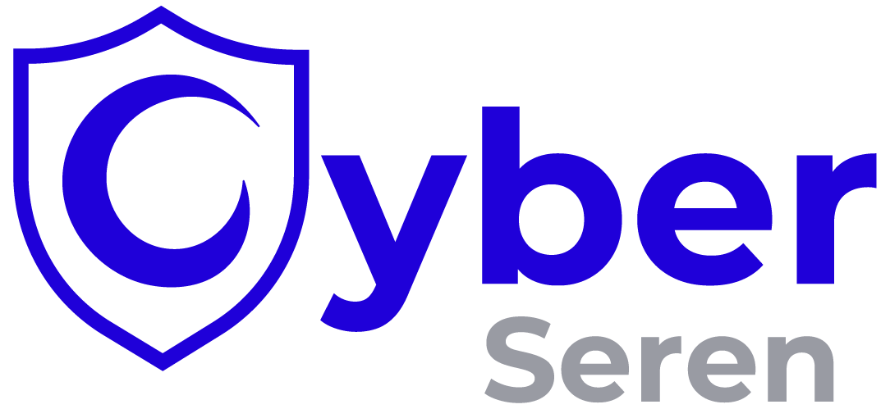
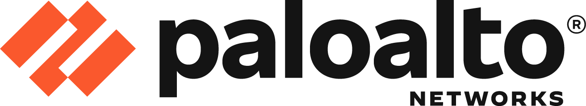

  <picture>
    <source media="(prefers-color-scheme: dark)" srcset="logo-dark.png">
    
  </picture>

<h3 align="center">La plateforme qui pilote votre sécurité.</h3>

CyberSeren réunit les solutions de cybersécurité leaders du marché sur sa plateforme Serenity, pour une vision unifiée de votre sécurité. Cybersécurité managée.

- **Serenity** : tableau de bord, assistant IA, automatisation par API, rapports périodiques.
- **Partenaire officiel Palo Alto Networks** : Prisma Browser, Strata NGFW, Prisma SASE, Cortex XDR.

### Open source

- [cyberseren-skills](https://github.com/cyberseren/cyberseren-skills) : skills d'agent IA pour les produits Palo Alto Networks. Skills Serenity à venir.

### Liens

[Site](https://cyberseren.com) · [Démonstration et audit gratuit](https://cyberseren.com/demonstration/) · [LinkedIn](https://www.linkedin.com/company/cyberseren) · [X](https://x.com/CyberSeren)

---

*CyberSeren brings leading cybersecurity solutions together on Serenity, its platform, for a unified view of your security. Official Palo Alto Networks partner.*

  Partenaire officiel&nbsp;&nbsp;
  <a href="https://www.paloaltonetworks.com">
    <picture>
      <source media="(prefers-color-scheme: dark)" srcset="paloalto-dark.png">
      
    </picture>
  </a>

